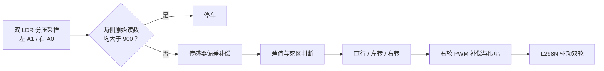
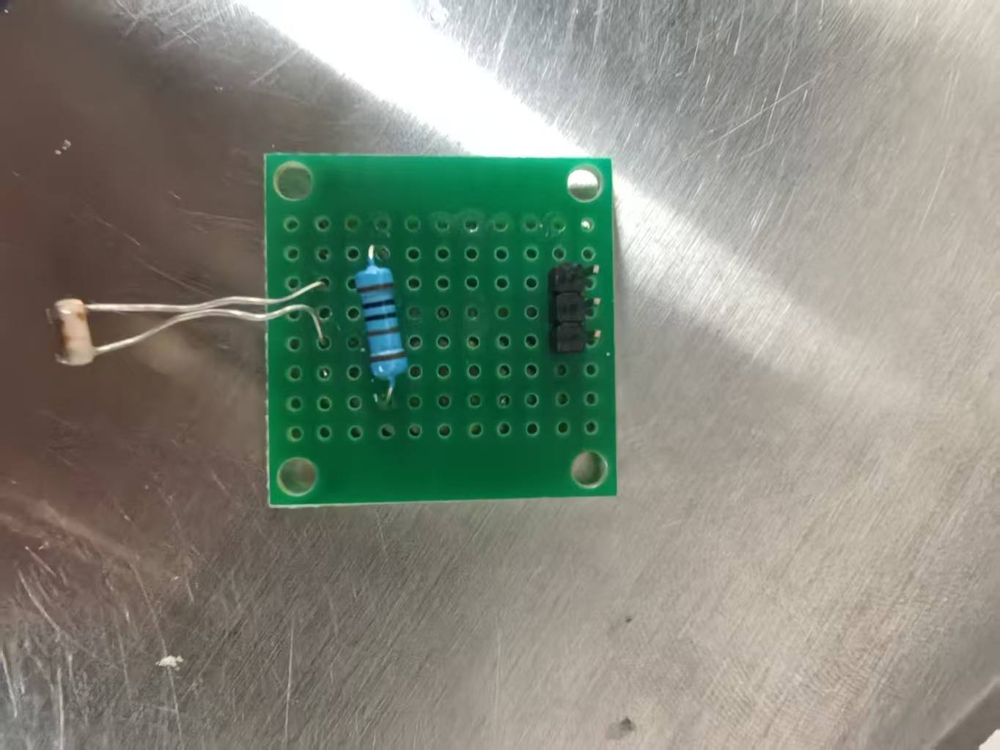
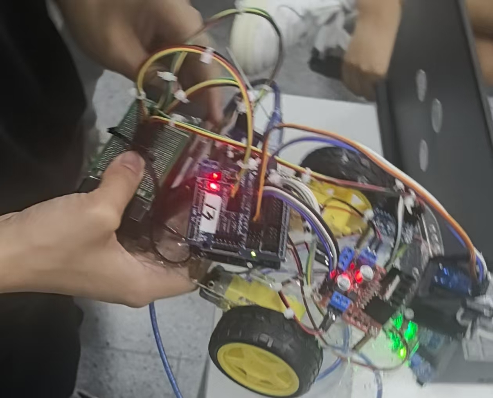

# Arduino 寻光小车

利用左右两路光敏电阻感知光照差异，通过 L298N 调节双轮 PWM，让小车朝较亮的一侧行驶。程序包含传感器偏差补偿、电机 PWM 补偿、转向死区和暗光停车。

**作者：Yuanxi HAN** · Arduino UNO R3 · L298N · 双 LDR · C++ / Arduino


Bus 造型小车的整车照片，提取自课程期末报告。照片中还包含其他实验模块，本目录的程序仅使用双 LDR 和双电机驱动。

**[观看寻光演示](https://www.bilibili.com/video/BV1PkKU6hEKu/)** · [查看程序](firmware/light_seeking/light_seeking.ino) · [原理与算法](docs/light-seeking-theory.md) · [接线与标定](docs/setup-and-calibration.md)

## 功能与控制方式

| 光照情况 | 小车行为 | 默认左 / 右轮 PWM |
| --- | --- | --- |
| 两侧读数接近，补偿后差值位于死区内 | 直行 | 105 / 119 |
| 左侧更亮，补偿后差值达到转向阈值 | 左轮降速，左转 | 35 / 119 |
| 右侧更亮，补偿后差值达到转向阈值 | 右轮降速，右转 | 105 / 49 |
| 两侧原始 ADC 读数均大于 900 | 停车 | 0 / 0 |

这里的数值是 PWM 指令，实际轮速会受到电池电压、电机差异和地面条件影响。程序采用固定差速的阈值控制。



## 硬件与实物

| 部件 | 数量 | 用途 |
| --- | --- | --- |
| Arduino UNO R3 | 1 | 两路模拟采样与电机控制 |
| LDR 光敏电阻 | 2 | 感知左右光照 |
| 分压固定电阻 | 2 | 将光敏阻值变化转换为电压；阻值按实际电路与标定选择 |
| L298N 双 H 桥驱动模块 | 1 | 双电机方向与 PWM 控制 |
| TT 减速电机、驱动轮 | 各 2 | 差速行驶 |
| 小车底盘、支撑轮、电源和连接线 | 1 套 | 装配、供电与连接 |



单路光敏采样电路的焊接实物。左右两路需要相同的分压接法，并对称安装以便比较光照。



内部布局用于展示控制板、电机驱动、电源与线束的安装。具体寻光引脚以本项目的接线表和程序为准。

## 快速运行

1. 按照[接线表](docs/setup-and-calibration.md#接线表)连接两路 LDR 与 L298N，确认照亮传感器时 ADC 读数减小。
2. 使用 Arduino IDE 打开 `firmware/light_seeking/light_seeking.ino`。草图只使用 Arduino 核心 API，无需第三方库。
3. 选择 Arduino UNO 和对应串口，执行编译并上传。
4. 打开 9600 baud 串口监视器，先在车轮悬空时检查电机前进方向和左右通道，再进行地面测试。
5. 将光源放在正前方、左侧和右侧，观察直行与转向；同时遮住两路 LDR，检查停车。

小车在上电后会立即进入寻光循环。[完整调试步骤](docs/setup-and-calibration.md)包含左右轮确认、光敏偏差与暗光阈值标定。

## 核心程序与参数

```cpp
// 光越强，读数越小；L 是右侧读数的补偿量。
int diff = (valR + L) - valL;

if (abs(diff) < thresh) {
  spdL = speedBase;
  spdR = speedBase + M;
} else if (diff > 0) {
  spdL = speedTurn;
  spdR = speedBase + M;
} else {
  spdL = speedBase;
  spdR = speedTurn + M;
}
```

暗光停车在上述转向判断之前执行，完整代码见[寻光草图](firmware/light_seeking/light_seeking.ino)。

| 原变量 | 默认值 | 作用 |
| --- | --- | --- |
| `L` | -3 | 加在右侧 ADC 读数上的补偿量 |
| `M` | 14 | 加在右轮 PWM 上的补偿量 |
| `speedBase` | 105 | 直行时左轮基准 PWM |
| `speedTurn` | 35 | 转向时内侧轮的基准 PWM |
| `thresh` | 13 | 死区阈值；`abs(diff) < 13` 才直行 |
| `darkThreshold` | 900 | 两侧原始读数均严格大于此值时停车 |

这些参数来自报告附录，复现时需要根据实际传感器、电机和照明条件重新标定。

## 调试过程与现有限制

课程报告记录了初次寻光时因左右轮差速过大而出现明显摆动，后续通过减小转向差速、调整传感器补偿改善运动平顺性。[原理文档](docs/light-seeking-theory.md)解释了传感器偏差与电机偏差如何分别影响控制。

当前版本包含以下行为边界：

- 明暗判断依赖接线极性，接成“越亮读数越大”时，转向和停车判断都会受到影响。
- 固定差速控制没有随误差连续调速，死区边缘仍可能出现左右切换。
- 两侧均暗时才停车，单侧遮挡会继续执行寻光；程序也没有到达光源后的距离停车判断。
- 代码没有固定采样周期，串口输出会影响循环速度。

## 验证

已通过主机 C++ 编译、初始化与串口输出检查，以及 20 个控制用例，覆盖转向、死区与暗光边界，以及 PWM 限幅。[测试](tests/README.md)使用 Arduino API 桩运行实际草图。

本次整理未进行 Arduino AVR 目标编译或实车复测；演示链接来自课程报告。代码与图片来源、报告文字和附录的差异见[素材与版本说明](docs/source-notes.md)。

## 目录

```text
arduino-car/
├── README.md
├── firmware/light_seeking/light_seeking.ino
├── docs/
│   ├── light-seeking-theory.md
│   ├── setup-and-calibration.md
│   └── source-notes.md
├── media/light-seeking/
└── tests/
```

本目录保留整理后的程序、图片和技术说明，完整课程报告留作原始资料。
