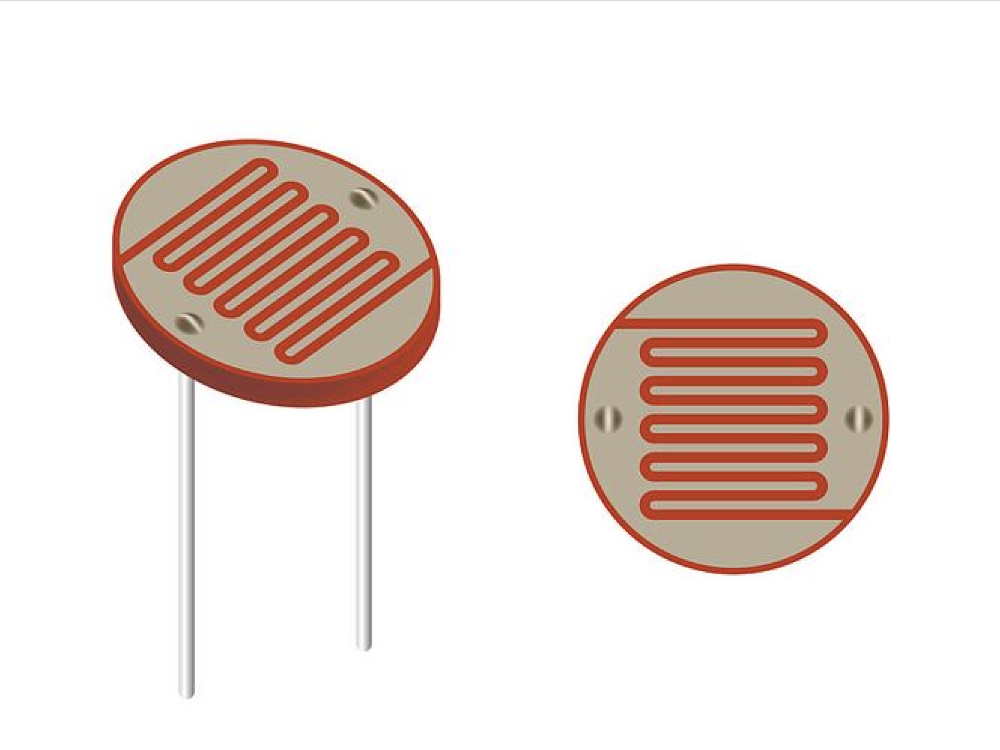
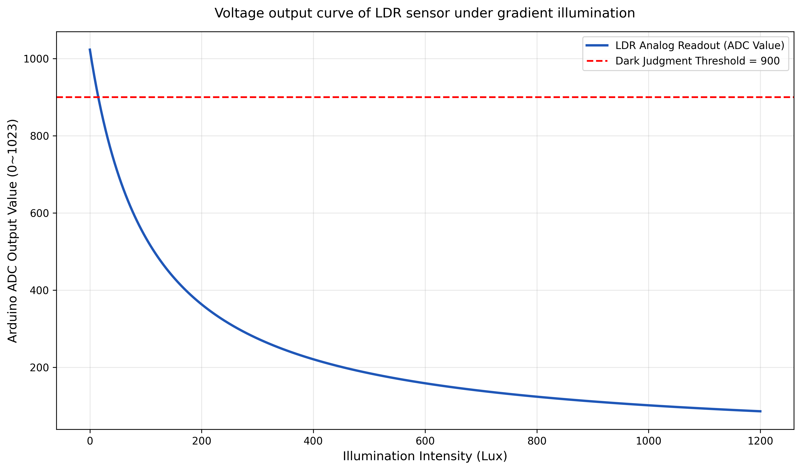

# 寻光原理与控制算法

小车利用左右两个光敏电阻采样，通过比较光照引起的电压差来决定转向。整个过程分为光电转换、差值计算和双轮差速三个环节。

## 光敏电阻与分压采样

光敏电阻 LDR 的阻值通常随入射光增强而减小。它本身不是直接输出电压的传感器，需要与固定电阻组成分压电路。



这张图用于识别 LDR 器件外形，来自报告 Figure 1；具体分压接法见下方示意。

本程序要求“越亮，ADC 读数越小”。一种符合该极性的单路分压电路如下，左右各使用一组：

```text
       +5 V
         |
      R_fixed
         |
         +------------ A0（右）或 A1（左）
         |
        LDR
         |
        GND
```

这是根据代码所需极性补充的接线示意。报告中的实物照片没有给出完整背面走线，因此复现时还需要用读数确认实际接法。

该接法中，采样的是 LDR 两端电压：

$$
V_{out}=V_{CC}\frac{R_{LDR}}{R_{fixed}+R_{LDR}}
$$

光增强时，`R_LDR` 减小，`V_out` 减小，ADC 读数随之减小。若交换 LDR 与固定电阻的位置，输出变化方向也会反转。

UNO R3 的模拟输入为 10 位，`analogRead()` 返回 0 到 1023。用端点近似表示电压与读数的关系：

$$
ADC\approx1023\frac{V_{out}}{V_{ref}}
$$

这里使用 UNO 默认模拟参考电压。板卡与 API 说明见 [Arduino analogRead 官方参考](https://github.com/arduino/reference-en/blob/master/Language/Functions/Analog%20IO/analogRead.adoc)。



报告 Figure 3 展示了“光越强，读数越小”及暗光阈值 900。图的纵轴标注为 ADC，横轴标注为 Lux；现有资料未提供对应的逐点测量数据和照度标定方法，因此这里将其用于解释响应方向，不能用它把 ADC 直接换算成实际照度。

## 为什么需要两个传感器

一个 LDR 只能反映所在位置的光照强弱；左右两路才能提供转向所需的相对差异。传感器对称安装后，左侧更亮通常使左侧 ADC 更小，右侧更亮通常使右侧 ADC 更小。

原程序定义：

```cpp
const int L = -3;
int diff = (valR + L) - valL;
```

`L` 是原变量名，补偿实际加在右侧读数上。这里的 `L` 不代表左轮指令。

| 补偿后的差值 | 解释 | 控制输出 |
| --- | --- | --- |
| `abs(diff) < 13` | 两侧差异较小 | 直行 |
| `diff >= 13` | 右侧读数更大，左侧相对更亮 | 左转 |
| `diff <= -13` | 左侧读数更大，右侧相对更亮 | 右转 |

例如 `valR=600、valL=300` 时，`diff=297`，程序选择左转。这里的数值仅为算法示例。

死区让小幅读数波动不会立即改变转向。不过单一死区没有滞回，差值在边界附近反复变化时，仍可能切换直行和转向。

## 双轮差速与 PWM

小车通过左右轮的速度差转向。左轮较慢时向左偏转，右轮较慢时向右偏转；这个对应关系依赖左右电机通道与前进方向接线正确。

UNO 使用 `analogWrite()` 输出 PWM，占空比指令范围为 0 到 255，D9 与 D10 支持该功能。PWM 的近似占空比为：

$$
D=\frac{PWM}{255}
$$

PWM 是通断占空比指令，不是轮速测量值。电机驱动、电源和负载都会影响实际轮速。[Arduino 官方 PWM 说明](https://support.arduino.cc/hc/en-us/articles/9350537961500-Use-PWM-output-with-Arduino)给出了 API 范围和支持的引脚；[ST L298 说明](https://www.st.com/en/motor-drivers/l298.html)介绍了双 H 桥及独立使能输入。

原程序的输出为：

| 状态 | 左轮 PWM | 右轮 PWM |
| --- | --- | --- |
| 直行 | `speedBase = 105` | `speedBase + M = 119` |
| 左转 | `speedTurn = 35` | `speedBase + M = 119` |
| 右转 | `speedBase = 105` | `speedTurn + M = 49` |
| 暗光停车 | 0 | 0 |

右轮的 `M=14` 是加性补偿，用来减小同一基准指令下的直行偏移。传感器补偿 `L` 解决输入偏差，电机补偿 `M` 解决输出偏差，两者应分别标定。

输出最终经 `constrain(..., 0, 255)` 限幅。原程序固定电机方向引脚为 `HIGH/LOW`，通过降低内侧轮 PWM 转弯，没有倒车或原地反向旋转逻辑。

## 暗光停车

```cpp
if (valR > darkThreshold && valL > darkThreshold) {
  drive(0, 0);
  return;
}
```

停车判断使用两侧原始 ADC 值，并且先于偏差补偿执行。默认阈值为 900：两路都是 901 时停车，两路都是 900 时继续控制，单路超过阈值也不会直接停车。

这个条件表示两侧都缺乏足够光照，不表示已经到达光源。光源很近时，只要没有满足暗光条件，程序仍可能前进。

## 从程序理解调试过程

报告记录了初次寻光时车身摆动明显，调整转向差速与传感器补偿后运行更平顺。从控制逻辑看，转向时内外轮差速会直接影响转弯强度；传感器偏差则会使均匀照明被误判为一侧更亮。

调试时先确认两路输入极性和电机方向，再校准传感器差异、直行补偿和转向参数，才能区分问题来自感知还是驱动。具体步骤见[接线与标定](setup-and-calibration.md)。

当前算法根据差值的符号和阈值选择固定 PWM 档位；误差从 20 增大到 200 不会继续增加转向强度。它是一种便于调试的阈值差速控制。连续比例调速、滞回和采样滤波可以作为后续改进，当前草图尚未实现。

[返回项目首页](../README.md)
