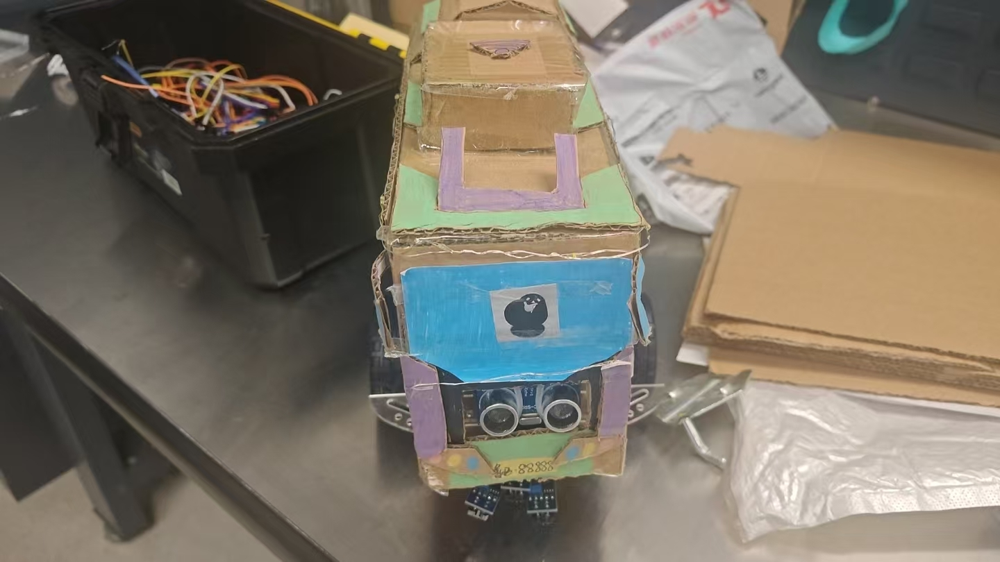

# 素材来源与版本说明

本项目的寻光代码和六张报告图片取自课程期末报告 `group13_finallab-4(1).pdf`。完整 PDF 未复制到仓库。作者与工作归属按 Yuanxi HAN 提供的实际完成情况整理。

源文件 SHA-256：

```text
a895f1f11d0c446456ab5457a03c8a1e81e7dc3463e8b0cdd17cd28d9956e6c2
```

以下“正文页码”指印在报告页面底部的页码，“PDF 页序”从文件第一页开始计数。

## 代码

`firmware/light_seeking/light_seeking.ino` 对应 3.1 Light Seeking Program，正文第 20-23 页，PDF 第 21-24 页。

整理时去除页眉、页码和穿插的图片标题，恢复缩进，补充中文注释、显式 `Arduino.h` 引用和 `drive()` 函数声明。原引脚、变量、参数、判断条件、串口文本与电机输出逻辑保持一致。

核心参数为 `M=14、L=-3、speedBase=105、speedTurn=35、thresh=13、darkThreshold=900`。保留的 `worring R:` 是报告原串口文本。

本次主机 C++ 编译、初始化与串口输出检查，以及 20 个控制用例均已通过。测试使用 Arduino API 桩；未进行 Arduino AVR 目标编译、烧录或实车复测。

## 图片

原图从 PDF 内嵌图像中提取，使用描述性文件名保存，没有重绘、裁切或添加标注。

| 文件 | 原图 | 正文页码 | PDF 页序 | 本项目中的用途 |
| --- | --- | --- | --- | --- |
| `ldr-component.png` | Figure 1 | 5 | 6 | LDR 器件外形；原图标题称 schematic，实际为器件示意图 |
| `ldr-sensor-board.jpg` | Figure 2 | 5 | 6 | 单路 LDR 与固定电阻焊接实物；照片未展示双路完整安装 |
| `ldr-response-curve.png` | Figure 3 | 6 | 7 | 光照与 ADC 变化方向、阈值示意 |
| `car-front.jpg` | Figure 15 | 19 | 20 | 小车正面照片，见本文下方 |
| `car-side.jpg` | Figure 16 | 20 | 21 | 首页整车照片；按实际画面标为侧面 |
| `car-internals.jpg` | Figure 17 | 21 | 22 | 整车内部布局 |



寻光演示链接来自报告正文第 36 页：

[Bilibili 寻光演示](https://www.bilibili.com/video/BV1PkKU6hEKu/)

## 原报告中需要区分的内容

| 内容 | 报告正文或图片 | 代码附录 / 本项目处理 |
| --- | --- | --- |
| 分压极性 | 正文的一处分压公式对应“光越强，读数越大” | 附录停车条件及 Figure 3 对应“越亮读数越小”；说明与接线示意按代码所需极性编写，实车需确认 |
| 暗光阈值 | 正文写两侧读数大于 1019 | 附录实际为 900，保留附录值 |
| 转向调速 | 正文提到按传感器差值比例调速 | 附录是固定 PWM 的三分支阈值控制，按实际代码说明 |
| 控制周期 | 正文提到 10 ms | 附录没有固定周期控制，不声明 10 ms 采样 |
| 转向灯 | 正文提到尾部 LED 联动 | 附录未包含 LED 引脚与逻辑，本版本不列为已实现功能 |
| Figure 4 | 标注为寻光 PCB 示意图 | 图中实际为发光二极管和光敏三极管耦合电路，不能作为 LDR 分压或 PCB 接线依据，未收入素材目录 |
| Figure 3 曲线 | 横轴为 Lux，曲线平滑 | 缺少对应原始数据和照度标定方法，用于定性说明，不生成或补造测量数据 |
| 评分与检测范围 | 正文给出 29/30 和 15 cm × 10 cm | 缺少评价细则和逐次测试记录，首页不列为复测指标 |

## 补充参考

技术说明中的 ADC、PWM 与驱动器基础信息核对自以下官方资料：

- [Arduino analogRead 官方参考](https://github.com/arduino/reference-en/blob/master/Language/Functions/Analog%20IO/analogRead.adoc)
- [Arduino PWM 输出说明](https://support.arduino.cc/hc/en-us/articles/9350537961500-Use-PWM-output-with-Arduino)
- [ST L298 产品说明](https://www.st.com/en/motor-drivers/l298.html)
- [ST L298 数据手册](https://www.st.com/resource/en/datasheet/l298.pdf)

[返回项目首页](../README.md)
